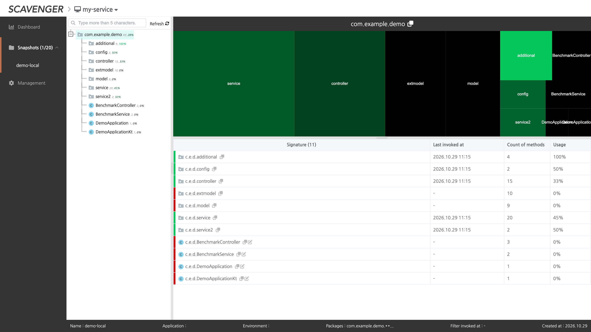
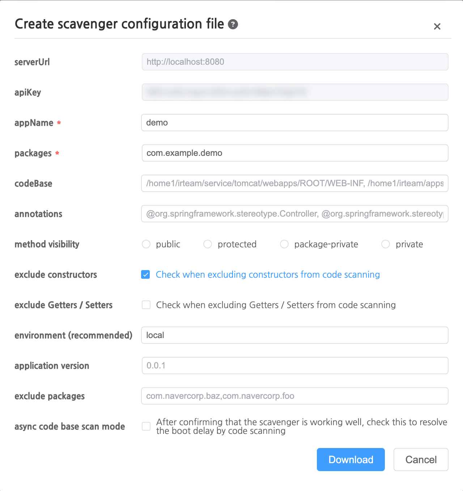
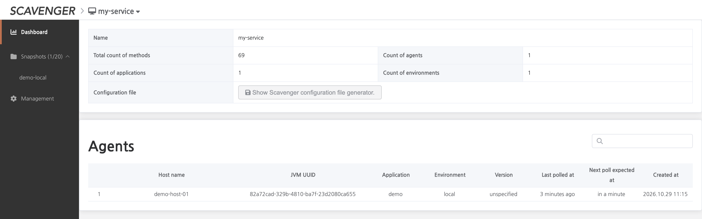
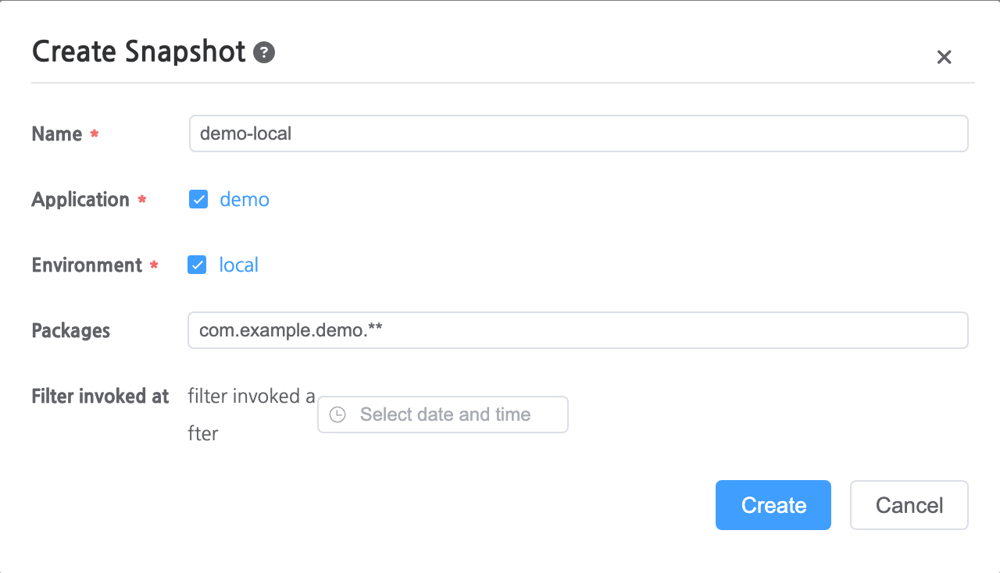

# Scavenger

<p align="center">
  <a href="https://github.com/naver/scavenger/releases"></a>
  <a href="https://central.sonatype.com/artifact/com.navercorp.scavenger/scavenger-agent-java"></a>
  <a href="LICENSE"></a>
</p>

**Scavenger finds dead code in running JVM applications.** Attach a Java agent, let your service
handle real traffic, and Scavenger shows which methods were never invoked — by package, class and
method, across applications and environments. No code changes, no rebuild.

<p align="center">
  
</p>

- [Why runtime analysis?](#-why-runtime-analysis)
- [How it works](#-how-it-works)
- [Features](#-features)
- [Requirements](#-requirements)
- [Quick start](#-quick-start)
- [Reading the results](#-reading-the-results)
- [Ask from your AI coding agent (MCP)](#-ask-from-your-ai-coding-agent-mcp)
- [Going to production](#-going-to-production)
- [Documentation](#-documentation)
- [Contributing](#-contributing)

## 🤔 Why runtime analysis?

Your IDE flags a method as unused only when nothing *references* it. In a long-lived service most
dead code is still referenced: an endpoint no client calls anymore, a branch behind a feature flag
that never flips, a batch step for a product that was retired. Static analysis cannot tell these
apart from live code. Runtime data can — it shows code that is **reachable but never reached**.

Scavenger records which methods of your packages are invoked and keeps that record over weeks or
months, so the decision to delete is backed by what actually ran.

Scavenger started from [Codekvast](https://github.com/crispab/codekvast), the first tool to bring
runtime dead-code analysis to Java. It rewrites most of the code, with a new UI and more elaborate
instrumentation.

## 🧩 How it works

```
 ┌─────────────────────────┐   codebase, invocations   ┌─────────────┐      ┌──────────────┐
 │ Your JVM application    │ ────── gRPC, ~2 min ────▶ │  Collector  │ ───▶ │   Database   │
 │ + scavenger-agent-java  │                           │    :8080    │      │ H2 / MySQL / │
 └─────────────────────────┘                           └─────────────┘      │    Vitess    │
                                                                            └──────┬───────┘
                                                                                   │
  Browser  ◀──── web UI, snapshots ────┐               ┌─────────────┐             │
                                       ├───────────────│     API     │ ◀───────────┘
  AI agent ◀──── MCP ──────────────────┘               │    :8081    │
                                                       └─────────────┘
```

1. At startup the **agent** scans your application for the methods in the configured `packages`
   (the *codebase*) and instruments them with [Byte Buddy](https://bytebuddy.net/).
2. It records which of those methods are invoked and publishes them to the **collector** — first
   about 10 seconds after startup, then about every 2 minutes.
3. The **API** serves the web UI, where you take **snapshots**: which methods were invoked in the
   applications and environments you pick. It also embeds an **MCP server** for AI coding agents.

## ✨ Features

- **No code changes** — a `-javaagent` flag and a configuration file.
- **Any JVM language** running on Java 8 or later. An [agent for Java 7](scavenger-old-agent-java)
  (no longer maintained) and a [Python agent (beta)](scavenger-agent-python) are also available.
- **Workspaces, applications and environments** — collect `dev`, `staging` and `prod` separately
  and combine them in one snapshot.
- **Snapshots** with a package tree, a usage treemap and the last invocation time of every method.
- **Call-stack tracking** (optional, `callStackTraceMode`) to see which method calls which.
- **MCP server** so AI coding agents can check "is this method used?" against real usage
  (on `develop`, not yet released).
- **H2** to try it out, **MySQL** or **Vitess** for production.

## 📋 Requirements

| Component | Requirement |
| --- | --- |
| Collector, API (v1.1.4) | JDK 25 or later |
| Java agent | An application on Java 8 or later (integration-tested on 8, 11, 17, 21 and 25) |
| Database | H2 (embedded, for trying out), MySQL or Vitess |
| Network | Agents → Collector `8080` (HTTP and gRPC). Users → API `8081` (UI, REST, MCP) |

## 🚀 Quick start

Run everything on one machine with the embedded H2 database. The steps below were run as written
with v1.1.4 on JDK 25.

### 1. Download

```bash
VERSION=1.1.4
curl -LO https://github.com/naver/scavenger/releases/download/v$VERSION/scavenger-collector-$VERSION.jar
curl -LO https://github.com/naver/scavenger/releases/download/v$VERSION/scavenger-api-$VERSION.jar
curl -LO https://repo1.maven.org/maven2/com/navercorp/scavenger/scavenger-agent-java/$VERSION/scavenger-agent-java-$VERSION.jar
```

### 2. Start the collector, then the API

```bash
java -Dspring.profiles.active=h2 -jar scavenger-collector-$VERSION.jar
```

```bash
# in another terminal
java -Dspring.profiles.active=h2 \
     -Dscavenger.collector-server-url=http://localhost:8080 \
     -jar scavenger-api-$VERSION.jar
```

> [!IMPORTANT]
> Use the `h2` profile on **both**. With it, the collector keeps its data in `~/.scavenger/db` and
> serves it on port `9091`, where the API connects — so start the collector first. Without the
> profile, each process gets its own in-memory database and the UI never sees agent data.

Open <http://localhost:8081/scavenger> and click **Create workspace**.

### 3. Generate the agent configuration

On the workspace dashboard, click **Show Scavenger configuration file generator**, fill in `appName`
and `packages`, and download `scavenger.conf`.

<p align="center">
  
</p>

The downloaded file looks like this:

```properties
serverUrl = http://localhost:8080
apiKey = <your workspace license key>
appName = demo
packages = com.example.demo
excludeConstructors = true
environment = local
```

`packages` takes comma-separated package names; their subpackages are included. Every key can also
be set as a system property (`-Dscavenger.apiKey=...`) or an environment variable
(`SCAVENGER_API_KEY=...`). A system property wins over an environment variable, which wins over
the file — handy for keeping the license key out of the file.

### 4. Attach the agent to your application

```bash
java -javaagent:scavenger-agent-java-$VERSION.jar \
     -Dscavenger.configuration=scavenger.conf \
     -jar your-app.jar
```

About 10 seconds after startup the agent reports for the first time, and the application appears
on the dashboard:

<p align="center">
  
</p>

### 5. Take a snapshot

Use your application for a while, then open **Snapshots** and click **Create**.

<p align="center">
  
</p>

> [!WARNING]
> The snapshot's **Packages** field is an Ant-style pattern with `.` as the separator. Write
> `com.example.demo.**` — a bare `com.example.demo` matches nothing and gives an empty snapshot.
> Leave the field empty to include everything.

Open the snapshot to get the view at the top of this page. In the treemap, green areas contain
invoked methods (brighter means a larger share was invoked) and black areas contain none; the table
lists the invoked share per package or class. A snapshot is computed when it is created: click
**Refresh** in the snapshot to include newer invocations.

## 🔎 Reading the results

"Never invoked" is evidence, not a verdict. Before deleting code, check that:

- **The observation window covers rare paths** — month-end batches, yearly jobs and failover code
  run on their own schedule.
- **Every instance and environment runs the agent** — the dashboard lists each connected JVM, and
  a snapshot covers only the applications and environments you selected.
- **The data is current** — a snapshot does not update by itself, so refresh it, and check
  *Last polled at* on the dashboard to see that the agents are still reporting.

## 🤖 Ask from your AI coding agent (MCP)

> [!NOTE]
> The MCP server is on `develop` and not in a release yet. To try it, build the API from source with
> `./gradlew assemble -p scavenger-api` and run `scavenger-api/build/libs/scavenger-api-*-SNAPSHOT.jar`
> in place of the released API jar — it works on the same database.

The API embeds an [MCP](https://modelcontextprotocol.io/) server at `/scavenger/mcp`, so an agent
such as Claude Code, Cursor or Codex can check real usage before it suggests deleting code. Register
it with your workspace license key, e.g. in Claude Code's `.mcp.json`:

```json
{
  "mcpServers": {
    "scavenger": {
      "type": "http",
      "url": "http://localhost:8081/scavenger/mcp",
      "headers": { "X-Scavenger-License-Key": "${SCAVENGER_LICENSE_KEY}" }
    }
  }
}
```

Then ask in plain language — *"Is `TestService.call()` still used?"*, *"Which methods in
`com.example.demo` were never invoked?"*. The agent picks from five read-only tools:

| Tool | Answers |
| --- | --- |
| `list_scopes` | Which applications and environments exist, and how long each has been collecting |
| `is_method_used` | Is this method invoked anywhere? |
| `get_method_callers` | Who calls this method? (needs `callStackTraceMode`) |
| `get_stale_methods` | Which methods were never invoked, or not for N days? |
| `get_pr_impact` | Usage of up to 200 methods at once, e.g. those a pull request touches |

Every answer carries `coverage` — when collection started and when an agent last reported — so the
agent can tell "unused" from "not observed yet". A response from the quick-start run above:

```jsonc
// get_pr_impact with an invoked, a never-invoked and an unknown signature
// (lastSeenAtMillis and knownSinceMillis left out)
{
  "ok": true,
  "data": {
    "methods": [
      { "signature": "com.example.demo.extmodel.MyExtensionModel.buildModels()", "usage": "NOT_INVOKED",
        "lastInvokedAtMillis": null, "observedInScopeSinceMillis": 1793240127524 },
      { "signature": "com.example.demo.service2.TestService.call()", "usage": "INVOKED",
        "lastInvokedAtMillis": 1793240100000, "observedInScopeSinceMillis": 1793240127525 }
    ],
    "unknownSignatures": [ "com.example.demo.Removed.gone()" ]
  },
  "coverage": [
    { "environment": "local", "collectingSinceMillis": 1793240116611, "agentAliveAtMillis": 1793240767380 }
  ],
  "dataFreshness": { "queryExecutedAtMillis": 1793240803934 }
}
```

See the [MCP server guide](doc/mcp-guide.md) for every argument, the response format and the
deployment checklist.

## 🏭 Going to production

- **Database** — run the collector and the API with `-Dspring.profiles.active=mysql` and the
  `spring.datasource.*` properties. See the [installation guide](doc/installation.md).
- **Collector URL** — set the API's `scavenger.collector-server-url` to the address your agents
  reach: the configuration generator writes it into `serverUrl`.
- **Access control** — the API has no built-in authentication and its REST API returns workspace
  license keys. Keep the UI and `/scavenger/api/**` behind your SSO or proxy; if you expose MCP,
  route only `/scavenger/mcp` (see the [MCP guide](doc/mcp-guide.md#deployment--security)).
- **Agent tuning** — once collection works, set `asyncCodeBaseScanMode=true` so the codebase scan
  no longer delays startup. For Spring and Lombok code, `excludeConstructors=true` and
  `excludeGetterSetter=true` remove methods that are always called or generated. All options are
  in the [configuration reference](doc/installation.md#configuration-2).

## 📚 Documentation

| Guide | Contents |
| --- | --- |
| [Installation](doc/installation.md) | Collector and API profiles, MySQL, every agent option |
| [User guide](doc/user-guide.md) | Workspaces, configuration files, snapshots |
| [MCP server](doc/mcp-guide.md) | Tools, response format, deployment and security |
| [Python agent (beta)](scavenger-agent-python/README.md) | Installing and configuring the Python agent |
| [Debugging the agent](doc/debugging.md) | Attaching a debugger to the agent |

### Components

| Module | Role |
| --- | --- |
| `scavenger-agent-java` | Java agent: scans the codebase and reports invocations |
| `scavenger-collector` | Receives agent data, stores it and cleans up stale data |
| `scavenger-api` | REST API, web UI host and MCP server |
| `scavenger-frontend` | Web UI, bundled into the API |
| `scavenger-agent-python` | Python agent (beta) |
| `scavenger-old-agent-java` | Agent for Java 7 (no longer maintained) |
| `scavenger-demo` | Sample application for tests and local runs |

## 🤝 Contributing

Scavenger welcomes any contributions from users.<br/>
Pull requests are the best way to propose changes to the codebase. We actively welcome your pull requests:

1. Fork the repo and create your branch from develop.
2. If you've added code that should be tested, add tests.
3. Ensure the test suite passes.
4. Issue that pull request!

Found a bug or have an idea? Please [open an issue](https://github.com/naver/scavenger/issues).

## 🔢 Versioning

For transparency and insight into our release cycle, and to strive to maintain backward compatibility, Scavenger will be
maintained under the Semantic Versioning guidelines to the greatest extent possible.

Releases will be numbered in the following format:

      `<major>.<minor>.<patch>`

Release will be constructed based on the following guidelines:

* Breaking backward compatibility bumps the major (and resets the minor and patch)
* New additions without breaking backward compatibility bump the minor (and reset the patch)
* Bug fixes and small enhancement. changes bump the patch

## 📄 License

```
Copyright 2023-present NAVER Corp.

Licensed under the Apache License, Version 2.0 (the "License");
you may not use this file except in compliance with the License.
You may obtain a copy of the License at

http://www.apache.org/licenses/LICENSE-2.0

Unless required by applicable law or agreed to in writing, software
distributed under the License is distributed on an "AS IS" BASIS,
WITHOUT WARRANTIES OR CONDITIONS OF ANY KIND, either express or implied.
See the License for the specific language governing permissions and
limitations under the License.
```
